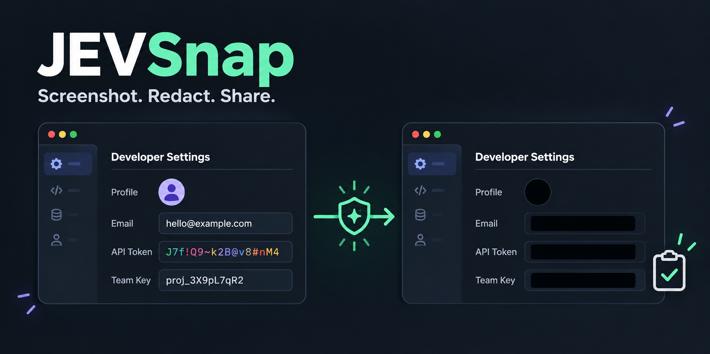

# JEVsnap



Screenshot hotkey that **automatically blacks out secrets and personal information** (API keys, tokens, emails,
phone numbers, names, internal hostnames, QR codes, …) before the image reaches your clipboard. Optional AI
checks use the [TypeSafe Jev](https://typesafe.ai) API.

> Unofficial community project, not affiliated with TypeSafe. **v0.2.** No automatic redactor is perfect;
> it lowers the chance of leaking something, it does not replace a quick look before you post.

| Platform | Folder | Stack | Status |
| --- | --- | --- | --- |
| macOS 13+ | [`macos/`](macos) | Swift, AppKit, Apple Vision OCR | Build verified on macOS; core and macOS test suites configured in CI. |
| Linux, Windows | [`desktop/`](desktop) | Electron + TypeScript, Tesseract OCR (bundled, offline) | Tested on Linux (unit tests, real Electron under a virtual display, packaged build). Windows is exercised only by CI. |

Both apps share the same design, settings and behavior, and a shared set of detector test vectors
([`shared/detector-cases.json`](shared/detector-cases.json)) keeps the Swift and TypeScript detectors identical.

## How it works

```
hotkey -> capture -> OCR (on-device)
              1. Local rules (regex + validators)            offline, always on
              2. Jev text check, then sensitive-word localization    only text is sent, secrets masked first
              3. Jev Box check (optional, off by default)    image sent only with earlier hits blacked out
          -> black boxes over every finding -> save redacted -> clipboard
```

What leaves your machine:

| Mode | Sent to TypeSafe |
| --- | --- |
| No API key | Nothing |
| Default (AI text check) | Only OCR'd **text**, with locally matched secrets replaced by `[HIDDEN]`. Never the image. |
| Visual check enabled | Also a downscaled copy of the screenshot with everything found so far already blacked out |

Fail-safe: if OCR or rendering fails, nothing is copied. If only the AI request fails, local rules still apply
(or the capture is cancelled, if you choose that setting). Required AI checks also cancel when the key is
missing, a response is incomplete, an image cannot be checked, or a configured check limit would skip work.
When character positions are unavailable, JEVsnap hides the whole word or line rather than estimating text
widths. Visible private-key blocks are hidden from their BEGIN marker through their END marker; without a
visible END marker, the remaining OCR lines are conservatively hidden.

Screenshots are saved only after processing: `Redacted/` contains images with redactions, and
`Not Redacted/` contains images where nothing needed hiding. Unredacted originals are never retained.
The macOS capture tool uses a private temporary file, removed after processing, cancellation, or failure.

## Upgrading to JEVsnap

The app, Swift modules, desktop packages, and build artifacts use the JEVsnap name. This app identity
starts with fresh settings: enter your API key and configure your preferences again. macOS needs a Screen Recording grant for the
`dev.jevsnap.app` identity; see the [permission recovery and signing instructions](macos/README.md#screen-recording-enabled-but-capture-still-asks-for-permission).

## Get the code

The repo is private, so sign in to GitHub first (e.g. `gh auth login`, or use a token/SSH key with access).

```bash
git clone https://github.com/brainstormity/JEVsnap.git
cd JEVsnap
```

Then follow [`macos/README.md`](macos/README.md) or [`desktop/README.md`](desktop/README.md).

## Repo layout

```
macos/     Swift app (menu bar, Vision OCR)           see macos/README.md
desktop/   Electron app for Linux + Windows           see desktop/README.md
shared/    detector test vectors used by both apps
tools/     mock Jev server, test-fixture generator
.github/   CI for both apps
```

## License

MIT
